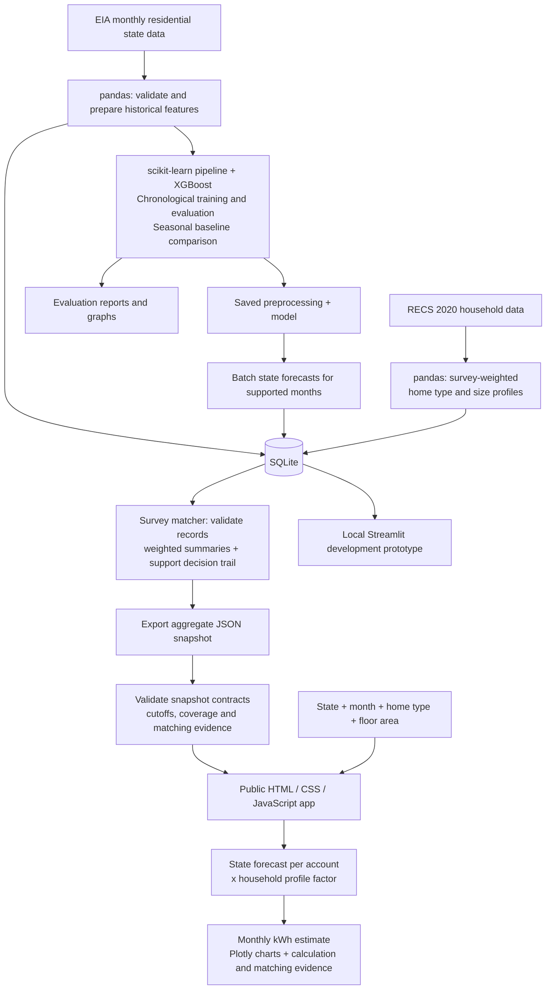
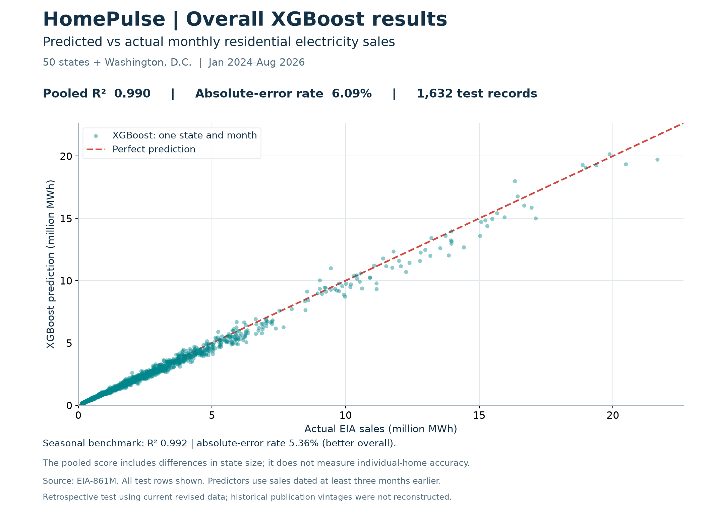
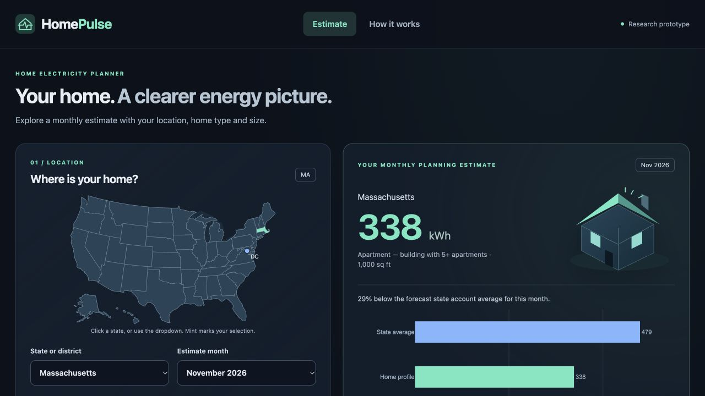
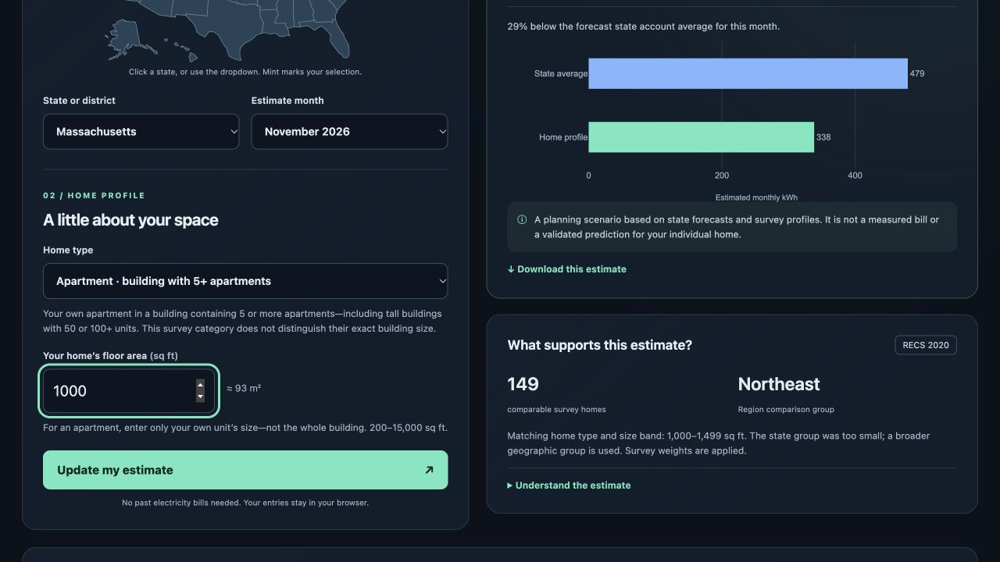
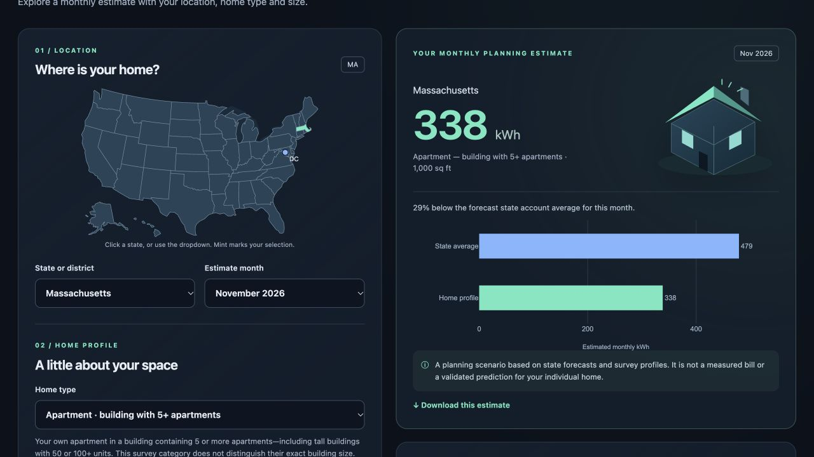
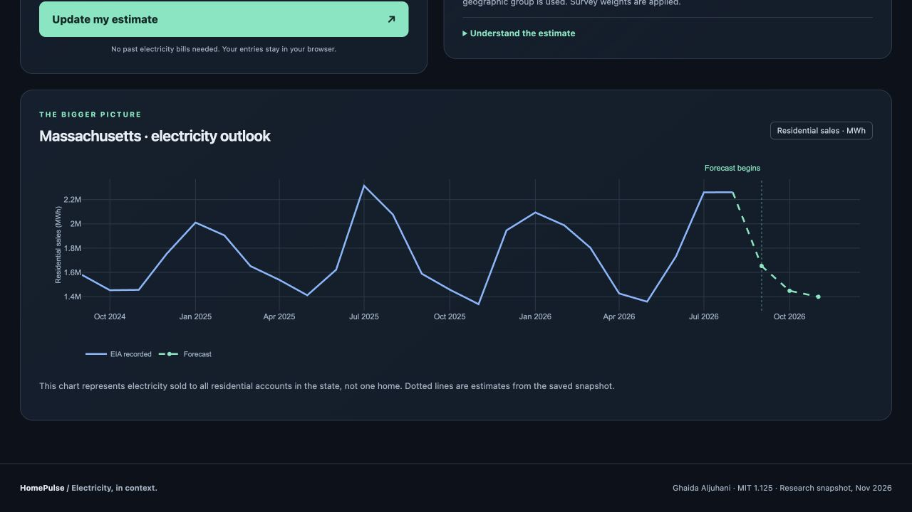
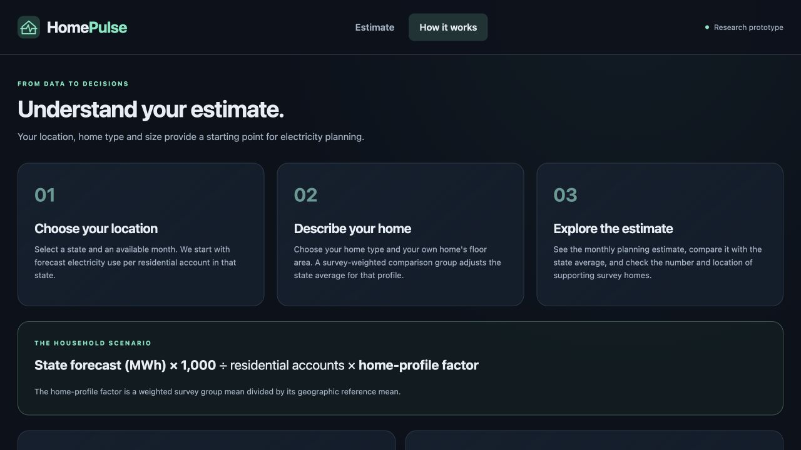
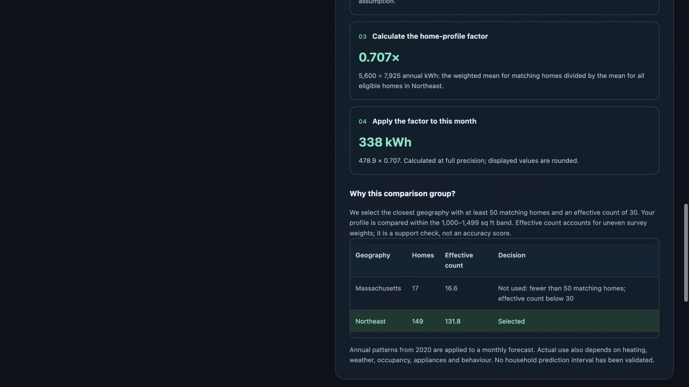

# HomePulse

**Household electricity planning · Midpoint implementation progress**  
Ghaida Aljuhani · MIT 1.125: Architecting and Engineering Software Systems  
Updated November 18, 2026

[Open the working app](https://homepulse-energy-planner.aljuhanighaida.chatgpt.site/) · [Installation and reproduction](docs/setup.md) · [Detailed architecture](docs/architecture.md) · [Supporting documents](docs/README.md)

This README follows the midpoint structure provided by Abel and John: introduction,
pitch, technology, code, demo, risks and next steps. It describes the implementation
completed so far and the evidence supporting it.

## 1. Introduction — what I built

HomePulse is a working web prototype for exploring household electricity use. A user
selects a **state, month, home type and floor area** to obtain a monthly electricity
planning estimate and compare it with the forecast average per residential account
in that state.

The implementation connects a Python data and modelling pipeline to an interactive
web interface. It includes data preparation, SQLite storage, state forecasting,
survey-based household comparisons, model evaluation, maps and charts.

## 2. Pitch — the problem and intended users

Someone considering a house or apartment may know its location, type and size but
have no electricity history for that property. HomePulse makes those familiar details
useful for comparing possible homes and exploring seasonal electricity patterns.
Its intended users are prospective renters, homebuyers and people comparing home
profiles for early planning.

The approach combines **state electricity forecasts** with **historical household
profiles**. The user receives an exploratory estimate in kWh/month. The state forecast
and household adjustment have separate evaluation evidence; individual monthly
household accuracy remains an open part of the project.

## 3. Technology — tools, data and system architecture

### Technologies implemented

| Technology | What it does | Where / when it runs |
|---|---|---|
| **Python** | Runs the data preparation, training, evaluation, database-building and export scripts | On the development machine when preparing a research snapshot |
| **pandas** | Reads and checks the EIA and RECS files; creates past-sales features, size bands and survey comparison groups | In the Python data pipeline |
| **scikit-learn** | Encodes state/month categories, combines preprocessing with XGBoost in one saved pipeline, and calculates R², MAE and RMSE | During model training and evaluation |
| **XGBoost** | Learns relationships between historical state sales and calendar features; produces monthly **state residential sales forecasts in MWh** | During offline training and batch forecasting |
| **SQLite** | Stores prepared observations, saved forecast values, household profiles, evaluation results and build metadata | In the offline pipeline and local prototype; exported to aggregate JSON for the public app |
| **JavaScript** | Validates the four user inputs, looks up a saved forecast and profile factor, calculates the home estimate and creates the downloadable JSON report | In the user's browser |
| **Plotly** | Draws the clickable U.S. map, state electricity outlook and state-average/home-profile comparison bars | In the public browser app; also used in the local prototype and evaluation charts |
| **HTML + CSS** | Define the form, navigation, explanatory panels and responsive dark-theme layout | In the public browser app |
| **Streamlit** | Provides the local Python development interface for inspecting estimates and charts | In the local prototype launched with `app.py` |

**Two different stages:** Python, pandas, scikit-learn and XGBoost prepare the
forecasts before publication. The published website uses JavaScript to retrieve
those saved values and apply the household adjustment. Changing the form updates
the calculation; it does not train or run XGBoost in the browser. Streamlit is the
local prototype, while HTML, CSS and JavaScript power the shareable website.

### Data used

| Dataset | Data in the project | Purpose |
|---|---|---|
| [EIA monthly state electricity data](https://www.eia.gov/electricity/data/state/) | 10,200 observations, January 2010–August 2026; 50 states plus Washington, D.C.; residential sales and account counts | Train and test state forecasts and calculate the average per residential account |
| [RECS 2020 public microdata](https://www.eia.gov/consumption/residential/data/2020/index.php?view=microdata) | 18,496 surveyed households with home characteristics, annual electricity use and survey weights | Build home-type/size comparison factors and investigate household prediction errors |

**Included data files:** [original EIA Excel workbook](data/sources/eia_monthly_state_sales.xlsx)
and [cleaned residential sales CSV](data/sources/monthly_residential_sales_2010_2026.csv).
The CSV contains all 10,200 historical observations used by the state study. See the
[data guide](data/README.md) for fields, coverage and checksums. The RECS household
CSV is downloaded separately by the supplied source script.

RECS stands for **Residential Energy Consumption Survey**. State electricity sales
mean electricity quantity in **MWh**, not sales revenue. The app converts to **kWh**
for the household scenario. Only the residential sector is used for the state forecast.

### Implemented architecture



**Model development happens offline.** The pipeline prepares and evaluates forecasts,
then saves the results in SQLite. An exporter creates the compact aggregate snapshot
used by the public app. The browser looks up a forecast and applies the household
factor when inputs change. Individual survey records and fitted models are not loaded
into the public interface. Technical XGBoost evaluation charts stay in the repository.

The original proposal's data preparation, storage, training, saved-model and user
interface stages are all represented. The published interface now uses JavaScript;
Streamlit remains available as the local development prototype.

## 4. Code — what has been implemented

For the important functions, engineering decisions and tests, see the
[code walkthrough](docs/code-walkthrough.md).

### A. Data preparation and validation

The state preparation code confirms the source columns represent **residential sales
in MWh**, converts numeric fields and dates, checks every state/month pair, and verifies
a complete monthly sequence. All **10,200 state observations** are retained. No valid
state observations or outliers were removed, and no missing values required imputation.

For the household profile calculation, 645 identified solar homes are excluded,
leaving **17,851 records**. This documented rule distinguishes purchased electricity
from total household use. Survey weights are retained so households contribute to
comparison means according to their representation in RECS.

Relevant code: [state preparation](experiments/state-forecast-20261113/run_experiment.py)
and [database builder](scripts/build_monthly.py).

### B. Historical features and model training

**What does the forecast depend on?** XGBoost predicts the total electricity sold
to **all residential accounts in one state during one month**, measured in MWh.
The pipeline builds its inputs automatically from the EIA historical state data:

| Forecast input | What the model uses it to learn |
|---|---|
| **State** | Differences in electricity-use patterns between states |
| **Target month and year** | Recurring seasonal patterns and changes over time; the code also includes days in the month and cyclic month encodings |
| **Past residential electricity sales** | Sales from 3, 4, 5, 6, 12, 13, 14, 15, 24 and 36 months earlier, expressed relative to the recent 12-month average |
| **Typical recent use** | The recent 12-month average, supplied in logarithmic form |
| **Growth and variability** | Changes in 12-month and three-month averages compared with the corresponding earlier year, plus variation around the recent average |

These historical inputs come from the dataset; users do not enter them. The app's
**state and month** select the saved forecast. **Home type and floor area** are used
later in the household adjustment described in section 4C.

**Historical cutoff:** for a target month, all electricity-use inputs are at least
**three months old**. For example, the November 2026 forecast uses observations
through August 2026. The recent 12-month average ends at that cutoff:

```python
g["recent_mean"] = y.shift(3).rolling(12).mean()
```

Categorical encoding and XGBoost are fitted together in a scikit-learn pipeline.
The selected model learns a log ratio relative to recent annual-average sales;
predictions are converted back to MWh before evaluation and app use.

| Stage | Target months | Role |
|---|---|---|
| Training | January 2013–September 2021 | Fit candidate models; earlier observations supply lag history |
| Validation | January 2022–September 2023 | Choose among six prespecified XGBoost settings using mean state WAPE |
| Refit | Through September 2023 | Fit the selected configuration before the historical test |
| Test | January 2024–August 2026 | Compare predictions with actual sales for 1,632 later state-month records |

The target month's actual electricity sales are excluded from prediction inputs.
Saved-model predictions, metrics and cutoff rules are independently checked. The test
uses updated lag histories for each month and revised historical source data; it is
not a single forecast made 32 months in advance.

Relevant code: [training pipeline](experiments/state-forecast-20261113/run_experiment.py)
and [independent verification](experiments/state-forecast-20261113/verify_and_report.py).

### C. Household calculation and app integration

**How does a state forecast become a home estimate?** The app combines the saved
state forecast with a survey-based home-profile factor in four steps:

1. **Look up the state forecast.** Use the selected state and month to retrieve the
   saved XGBoost forecast of residential electricity sales in MWh.
2. **Calculate the state average per account.** Multiply by **1,000** to convert MWh
   to kWh, then divide by the assumed number of residential electricity accounts.
   The account count is held at the latest observation allowed by the three-month
   cutoff; it is not separately forecast.
3. **Find a comparable home profile.** Use the selected home type and floor-area
   band to find similar RECS 2020 homes. Calculate their survey-weighted mean annual
   electricity use and divide it by the weighted mean for all retained survey homes
   in the same comparison geography. This produces a unitless adjustment factor.
4. **Apply the factor.** Multiply the forecast monthly state average per account by
   that factor to obtain the monthly household planning estimate in kWh.

The implemented formulas are:

```text
Monthly household scenario (kWh)
  = forecast state residential sales (MWh)
  × 1,000
  ÷ assumed residential account count
  × survey-weighted home-profile factor

Home-profile factor
  = survey-weighted annual mean for the selected home type and size band
  ÷ survey-weighted annual mean for all retained homes in the same geography
```

**Worked example from the current app:** Massachusetts, November 2026, an apartment
in a building with 5+ apartments, and 1,000 sq ft:

| Calculation | Value (rounded) |
|---|---:|
| Forecast state residential sales | 1,399,130 MWh |
| Assumed residential accounts | 2,921,850 |
| State average: forecast × 1,000 ÷ accounts | 478.85 kWh/account for the month |
| RECS home-profile factor | 0.7066 |
| Home estimate: state average × factor | **338 kWh for the month** |

The factor uses **149 Northeast survey homes** in the selected type and size band.
Matching tries the state, then region, then national sample. A comparison needs at
least **50 survey records** and an **effective sample size of 30**; unsupported
profiles receive no estimate. Floor area is grouped into bands, so homes with the
same type, geography and size band receive the same adjustment.

This calculation assumes that relative differences between annual RECS 2020 home
profiles also apply to the selected forecast month. Residential accounts and
occupied homes are different populations. The result is a **household planning
scenario** whose individual monthly accuracy requires separate validation; the
state forecast's R² does not establish that accuracy.

The comparison engine now records the rejected and selected geography attempts,
validates the survey records and caches weighted group summaries. Browser checks
reject inconsistent forecasts, factors or support decisions before displaying an
estimate. See [matching and validation details](docs/code-walkthrough.md).

Relevant code: [survey matcher](src/homepulse/peer_matching.py),
[Python calculation](src/homepulse/monthly.py),
[SQLite-to-web export](web-app-20261116/scripts/export_snapshot.py),
[browser calculation](web-app-20261116/dist/model.js)
and [public interface](web-app-20261116/dist/app.js).

### D. Evaluation and software verification

**State forecasting — same 1,632 test observations:**

| Metric | XGBoost | Prior three-year same-month mean |
|---|---:|---:|
| Pooled R² | 0.9902 | 0.9924 |
| MAE, MWh per state-month | 151,477 | 133,306 |
| WAPE | 6.09% | 5.36% |

R² measures how well predictions explain variation in the actual values. MAE is the
average absolute error; WAPE is total absolute error divided by total actual sales.
The seasonal baseline performs better overall. Pooled R² also reflects differences
in state size; median within-state XGBoost R² is 0.852. All per-state results are kept
in the [state metrics](reports/monthly/test-state-metrics.csv).



*The graph evaluates state electricity sales. Its score does not measure individual
household accuracy. See the [state evaluation report](reports/monthly/accuracy-check-20261114/accuracy-review.md).*

**Household investigations:** a separate annual RECS diagnostic on 3,515 supported
evaluation homes produced R² **0.279** and MAE **4,259 kWh/year**, a **10.7%** improvement
over a regional median. It missed the provisional 15% improvement target; 56 further
homes lacked sufficient support. A separate apartment experiment found that adding
bedrooms, building age and heating fuel reduced paired annual MAE from **2,640 to
2,377 kWh**. Those extra questions have not been added to the app. Both investigations
use previously explored 2020 records and do not validate future monthly household use.

See the [household report](reports/household-validation-20261115/household-validation-report.md)
and [apartment experiment](reports/apartment-inputs-20261116/apartment-input-report.md)
for subgroup errors, weights, uncertainty and full results.

**Software checks completed:**

- **23 Python matching/monthly/map tests** passed in the existing project environment.
- **24 deliberately corrupted snapshots** are rejected by the browser data contracts.
- All **3,366 previous-release scenarios** are numerically unchanged; the new evidence
  exposes existing calculations and adds integrity checks, not an accuracy claim.
- **3,366 supported browser calculations** match saved Python reference results.
- **408 unsupported profile groups** and invalid-input boundaries are checked.
- All **153 exported forecasts** match the report CSV; all **1,632 exported test rows**
  match the evaluation evidence.
- A separate fresh-environment data/model rebuild was verified on November 14;
  [setup evidence](docs/setup-verification-20261114.md) records its platform and limits.

These checks establish implementation consistency separately from predictive accuracy.

## 5. Demo — what currently works

[Open HomePulse](https://homepulse-energy-planner.aljuhanighaida.chatgpt.site/) to try
the same walkthrough. These screenshots were captured from the published app on
November 17, 2026. The example uses **Massachusetts, November 2026, a 1,000 sq ft
apartment in a building with 5+ apartments**.

### 5.1 Choose a location and month



Click a state on the interactive **Plotly U.S. map**, or select it from the dropdown.
The selected state is highlighted in mint. Choose an available month from
**September–November 2026**. These choices load the corresponding saved state forecast
and update the estimate and charts. The screenshot shows Massachusetts and November.

### 5.2 Describe the home and check its comparison group



Choose a home type and enter the floor area of the **individual home or apartment**,
then click **Update my estimate**. “5+ apartments” means the number of apartments in
the building, not bedrooms; 1,000 sq ft refers to this apartment alone. The support
panel shows **149 comparable Northeast survey homes**. A regional group is used
because the matching Massachusetts sample is too small. Survey weights are applied
when calculating the comparison factor.

### 5.3 Read the estimate and compare it with the state average



This example produces approximately **338 kWh for the selected month**, compared
with **479 kWh per residential account** in the state. The Plotly bars show the
forecast state average in blue and the adjusted home profile in mint—about **29%
below** the state average. Both values are estimates. The household result is a
planning scenario based on a state forecast and historical survey profiles; it is
not a measured bill or a validated prediction for this individual apartment.

### 5.4 Explore the state's electricity outlook



The blue line shows **recorded monthly residential electricity sales** for the whole
state. The mint dashed line shows the saved **September–November 2026 forecasts**.
August connects to September with a dashed segment, and **Forecast begins** marks
the first forecast month. Hover over the Plotly chart to inspect monthly values.
The vertical axis is **MWh for all residential accounts in the state**, whereas the
home estimate above is **kWh for one home profile**.

### 5.5 Understand the calculation and save the result



The **How it works** page explains the three user steps and the calculation:
state forecast × 1,000 ÷ residential accounts × home-profile factor. It also provides
data-source links and explains the research snapshot and comparison rules. Return
to **Estimate** and choose **Download this estimate** to save a JSON report containing
the selected profile, calculation results, snapshot date and source links. User
entries stay in the browser.

### 5.6 Inspect the calculation and geographic fallback



Expand **See the calculation & matching evidence** below the estimate. Four steps
show the state forecast, the account average, the survey factor and the final kWh.
The decision table explains why Massachusetts' **17 matching homes** fail the support
rules and the **149 Northeast homes** are used instead. Its effective count also
checks whether a few large survey weights dominate the sample. The download includes
this decision trail and the database checksum. This image was captured from the
tested local November 18 update; the earlier walkthrough images show the November 17 release.

To run the same prepared interface locally:

```bash
python3 -m http.server 8767 --directory web-app-20261116/dist
```

Open `http://127.0.0.1:8767/`. The prepared web snapshot does not require an ML package
installation. Full build and verification commands are in [setup instructions](docs/setup.md).

## 6. Risks — what remains uncertain

| Remaining issue | Current response |
|---|---|
| Individual monthly household accuracy | Keep the result labelled as a planning scenario; retain household diagnostics and investigate compatible monthly validation data |
| Transferring 2020 annual profiles to future months | Explain the age and annual-to-monthly assumption, use survey weights, enforce sample support and report geographic fallback |
| XGBoost versus the stronger seasonal benchmark | Report both methods on the same observations and plan further evaluation before changing the deployed method |
| Reproducibility as sources change | Preserve checksums and dependency versions; the downloader stops when a source release differs from the studied snapshot |

The annual diagnostic's nominal 80% interval achieved 80.2% coverage, but was broad
(about ±6,455 kWh/year). It is not used as a monthly household prediction interval.

## 7. Next steps — before the final project

1. Define a practical household error tolerance and strengthen validation of the final
   household output, including differences by home type and region.
2. Evaluate any model or baseline change on a separately planned period or compatible
   independent data; retain the existing results for comparison.
3. Test usability with intended users, refine apartment explanations and verify the
   app on additional screen sizes and devices.
4. Preserve the remaining household source snapshot and check installation on another machine; the studied state workbook is now included.

**Midpoint status:** the data pipeline, modelling workflow, saved forecasts, household
profile calculation and public prototype are implemented. The principal remaining
technical task is establishing the reliability of individual monthly household estimates.

## Repository guide

| Location | Contents |
|---|---|
| `README.md` | Project purpose, completed work, technology, code, demo, results and next steps |
| `data/` | Original EIA state workbook, cleaned residential sales CSV and provenance |
| `docs/` | Architecture, data/cleaning, evaluation, setup, feedback and RECS codebook |
| `scripts/` | Source download, SQLite build, chart generation and repository checks |
| `src/homepulse/` | Python calculation, data utilities and Streamlit prototype |
| `experiments/` | Selected state, household and apartment investigations |
| `reports/` | Evaluation graphs, metrics, test predictions and audit evidence |
| `tests/` | Python tests for implementation behavior |
| `web-app-20261116/` | Public web app, aggregate snapshot and browser/Python checks |

The [file manifest](docs/github-upload-files.txt) lists the selected repository contents.
The complete [architecture description](docs/architecture.md) explains storage,
execution paths, units and model artifacts. [Instructor feedback responses](docs/feedback-response-20261114.md)
connect the implementation evidence to Abel and John's suggestions.
