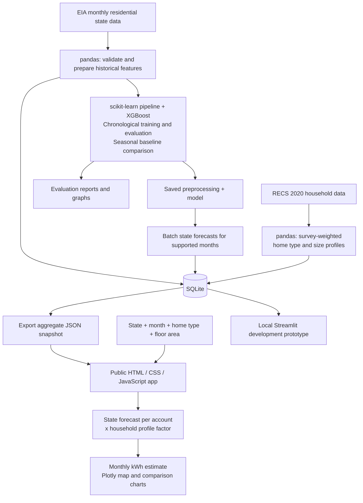

# HomePulse

**Household electricity planning · Midpoint implementation progress**  
Ghaida Aljuhani · MIT 1.125: Architecting and Engineering Software Systems  
Updated November 17, 2026

[Open the working app](https://homepulse-energy-planner.aljuhanighaida.chatgpt.site/) · [Installation and reproduction](docs/setup.md) · [Detailed architecture](docs/architecture.md) · [Supporting documents](docs/README.md)

This README follows the midpoint structure provided by Abel and John: introduction,
pitch, technology, code, demo, risks and next steps. It describes the implementation
completed so far and the evidence supporting it.

## 1. Introduction — what I built

HomePulse is a working web prototype for exploring household electricity use. A user
selects a **state, month, home type and floor area** to obtain a monthly electricity
planning estimate and compare it with the forecast average per residential account
in that state.

The implementation connects a Python data and modelling pipeline to an interactive
web interface. It includes data preparation, SQLite storage, state forecasting,
survey-based household comparisons, model evaluation, maps and charts.

## 2. Pitch — the problem and intended users

Someone considering a house or apartment may know its location, type and size but
have no electricity history for that property. HomePulse makes those familiar details
useful for comparing possible homes and exploring seasonal electricity patterns.
Its intended users are prospective renters, homebuyers and people comparing home
profiles for early planning.

The approach combines **state electricity forecasts** with **historical household
profiles**. The user receives an exploratory estimate in kWh/month. The state forecast
and household adjustment have separate evaluation evidence; individual monthly
household accuracy remains an open part of the project.

## 3. Technology — tools, data and system architecture

### Technologies implemented

| Technology | How it is used in HomePulse |
|---|---|
| **Python** | Runs data preparation, model development, evaluation, database creation and snapshot export |
| **pandas** | Reads the EIA workbook and RECS CSV, checks data types and dates, prepares historical features and weighted household profiles |
| **SQLite** | Stores prepared observations, forecasts, household profile records, evaluation results and build metadata |
| **scikit-learn** | Encodes categorical inputs, keeps fitted preprocessing with the model, and calculates evaluation metrics |
| **XGBoost** | Learns from past state residential electricity sales and calendar features to forecast later state totals |
| **Plotly** | Provides the clickable U.S. map, monthly outlook and home-profile comparison charts |
| **Streamlit** | Provides the local Python development prototype used to inspect the calculation and charts |
| **HTML, CSS and JavaScript** | Power the published dark-theme web app, its four-input form, browser calculation and downloadable results |

### Data used

| Dataset | Data in the project | Purpose |
|---|---|---|
| [EIA monthly state electricity data](https://www.eia.gov/electricity/data/state/) | 10,200 observations, January 2010–August 2026; 50 states plus Washington, D.C.; residential sales and account counts | Train and test state forecasts and calculate the average per residential account |
| [RECS 2020 public microdata](https://www.eia.gov/consumption/residential/data/2020/index.php?view=microdata) | 18,496 surveyed households with home characteristics, annual electricity use and survey weights | Build home-type/size comparison factors and investigate household prediction errors |

**Included data files:** [original EIA Excel workbook](data/sources/eia_monthly_state_sales.xlsx)
and [cleaned residential sales CSV](data/sources/monthly_residential_sales_2010_2026.csv).
The CSV contains all 10,200 historical observations used by the state study. See the
[data guide](data/README.md) for fields, coverage and checksums. The RECS household
CSV is downloaded separately by the supplied source script.

RECS stands for **Residential Energy Consumption Survey**. State electricity sales
mean electricity quantity in **MWh**, not sales revenue. The app converts to **kWh**
for the household scenario. Only the residential sector is used for the state forecast.

### Implemented architecture



**Model development happens offline.** The pipeline prepares and evaluates forecasts,
then saves the results in SQLite. An exporter creates the compact aggregate snapshot
used by the public app. The browser looks up a forecast and applies the household
factor when inputs change. Individual survey records and fitted models are not loaded
into the public interface. Technical XGBoost evaluation charts stay in the repository.

The original proposal's data preparation, storage, training, saved-model and user
interface stages are all represented. The published interface now uses JavaScript;
Streamlit remains available as the local development prototype.

## 4. Code — what has been implemented

### A. Data preparation and validation

The state preparation code confirms the source columns represent **residential sales
in MWh**, converts numeric fields and dates, checks every state/month pair, and verifies
a complete monthly sequence. All **10,200 state observations** are retained. No valid
state observations or outliers were removed, and no missing values required imputation.

For the household profile calculation, 645 identified solar homes are excluded,
leaving **17,851 records**. This documented rule distinguishes purchased electricity
from total household use. Survey weights are retained so households contribute to
comparison means according to their representation in RECS.

Relevant code: [state preparation](experiments/state-forecast-20261113/run_experiment.py)
and [database builder](scripts/build_monthly.py).

### B. Historical features and model training

The state model uses state/calendar fields, past electricity sales, seasonal values
and historical growth measures. For a target month, electricity-use inputs are at least
**three months old**. For example, this implemented feature uses only earlier values:

```python
g["recent_mean"] = y.shift(3).rolling(12).mean()
```

Categorical encoding and XGBoost are fitted together in a scikit-learn pipeline.
The selected model learns a log ratio relative to recent annual-average sales;
predictions are converted back to MWh before evaluation and app use.

| Stage | Target months | Role |
|---|---|---|
| Training | January 2013–September 2021 | Fit candidate models; earlier observations supply lag history |
| Validation | January 2022–September 2023 | Choose among six prespecified XGBoost settings using mean state WAPE |
| Refit | Through September 2023 | Fit the selected configuration before the historical test |
| Test | January 2024–August 2026 | Compare predictions with actual sales for 1,632 later state-month records |

The target month's actual electricity sales are excluded from prediction inputs.
Saved-model predictions, metrics and cutoff rules are independently checked. The test
uses updated lag histories for each month and revised historical source data; it is
not a single forecast made 32 months in advance.

Relevant code: [training pipeline](experiments/state-forecast-20261113/run_experiment.py)
and [independent verification](experiments/state-forecast-20261113/verify_and_report.py).

### C. Household calculation and app integration

The implemented calculation is:

```text
Monthly household scenario (kWh)
  = forecast state residential sales (MWh)
  × 1,000
  ÷ assumed residential account count
  × survey-weighted home-profile factor
```

The profile factor compares the weighted annual mean for the selected home type and
size band with the all-home mean in the same geography. Matching tries the state,
then region, then national sample. A comparison needs at least **50 survey records**
and an **effective sample size of 30**; unsupported profiles receive no estimate.
Account counts use the latest observation allowed by the forecast cutoff.

Relevant code: [Python calculation](src/homepulse/monthly.py),
[SQLite-to-web export](web-app-20261116/scripts/export_snapshot.py),
[browser calculation](web-app-20261116/dist/model.js)
and [public interface](web-app-20261116/dist/app.js).

### D. Evaluation and software verification

**State forecasting — same 1,632 test observations:**

| Metric | XGBoost | Prior three-year same-month mean |
|---|---:|---:|
| Pooled R² | 0.9902 | 0.9924 |
| MAE, MWh per state-month | 151,477 | 133,306 |
| WAPE | 6.09% | 5.36% |

R² measures how well predictions explain variation in the actual values. MAE is the
average absolute error; WAPE is total absolute error divided by total actual sales.
The seasonal baseline performs better overall. Pooled R² also reflects differences
in state size; median within-state XGBoost R² is 0.852. All per-state results are kept
in the [state metrics](reports/monthly/test-state-metrics.csv).


*The graph evaluates state electricity sales. Its score does not measure individual
household accuracy. See the [state evaluation report](reports/monthly/accuracy-check-20261114/accuracy-review.md).*

**Household investigations:** a separate annual RECS diagnostic on 3,515 supported
evaluation homes produced R² **0.279** and MAE **4,259 kWh/year**, a **10.7%** improvement
over a regional median. It missed the provisional 15% improvement target; 56 further
homes lacked sufficient support. A separate apartment experiment found that adding
bedrooms, building age and heating fuel reduced paired annual MAE from **2,640 to
2,377 kWh**. Those extra questions have not been added to the app. Both investigations
use previously explored 2020 records and do not validate future monthly household use.

See the [household report](reports/household-validation-20261115/household-validation-report.md)
and [apartment experiment](reports/apartment-inputs-20261116/apartment-input-report.md)
for subgroup errors, weights, uncertainty and full results.

**Software checks completed:**

- **10 Python monthly/map tests** passed in the existing project environment.
- **3,366 supported browser calculations** match saved Python reference results.
- **408 unsupported profile groups** and invalid-input boundaries are checked.
- All **153 exported forecasts** match the report CSV; all **1,632 exported test rows**
  match the evaluation evidence.
- A separate fresh-environment data/model rebuild was verified on November 14;
  [setup evidence](docs/setup-verification-20261114.md) records its platform and limits.

These checks establish implementation consistency separately from predictive accuracy.

## 5. Demo — what currently works

[Open HomePulse](https://homepulse-energy-planner.aljuhanighaida.chatgpt.site/) and:

1. Choose a state using the clickable U.S. map or dropdown.
2. Select an available month in **September–November 2026**.
3. Select the home type and enter the floor area of the user's own home or apartment.
4. View the monthly estimate, state-account comparison, survey support and Plotly charts.
5. Open **How it works** or download the estimate report.

Apartment categories describe **apartments in the building**, not bedrooms. For a
large building, users select “5+ apartments” and enter only their own unit's floor area.

**Example:** Massachusetts, November 2026, apartment in a building with 5+ apartments,
1,000 sq ft → approximately **338 kWh/month**, compared with **479 kWh** per state
residential account. The profile uses **149 Northeast survey homes** after the state
sample fails the support rule. This is an illustrative planning result, not a measured
bill or a validated precise estimate for that apartment.

To run the same prepared interface locally:

```bash
python3 -m http.server 8767 --directory web-app-20261116/dist
```

Open `http://127.0.0.1:8767/`. The prepared web snapshot does not require an ML package
installation. Full build and verification commands are in [setup instructions](docs/setup.md).

## 6. Risks — what remains uncertain

| Remaining issue | Current response |
|---|---|
| Individual monthly household accuracy | Keep the result labelled as a planning scenario; retain household diagnostics and investigate compatible monthly validation data |
| Transferring 2020 annual profiles to future months | Explain the age and annual-to-monthly assumption, use survey weights, enforce sample support and report geographic fallback |
| XGBoost versus the stronger seasonal benchmark | Report both methods on the same observations and plan further evaluation before changing the deployed method |
| Reproducibility as sources change | Preserve checksums and dependency versions; the downloader stops when a source release differs from the studied snapshot |

The annual diagnostic's nominal 80% interval achieved 80.2% coverage, but was broad
(about ±6,455 kWh/year). It is not used as a monthly household prediction interval.

## 7. Next steps — before the final project

1. Define a practical household error tolerance and strengthen validation of the final
   household output, including differences by home type and region.
2. Evaluate any model or baseline change on a separately planned period or compatible
   independent data; retain the existing results for comparison.
3. Test usability with intended users, refine apartment explanations and verify the
   app on additional screen sizes and devices.
4. Preserve the remaining household source snapshot and check installation on another machine; the studied state workbook is now included.

**Midpoint status:** the data pipeline, modelling workflow, saved forecasts, household
profile calculation and public prototype are implemented. The principal remaining
technical task is establishing the reliability of individual monthly household estimates.

## Repository guide

| Location | Contents |
|---|---|
| `README.md` | Project purpose, completed work, technology, code, demo, results and next steps |
| `data/` | Original EIA state workbook, cleaned residential sales CSV and provenance |
| `docs/` | Architecture, data/cleaning, evaluation, setup, feedback and RECS codebook |
| `scripts/` | Source download, SQLite build, chart generation and repository checks |
| `src/homepulse/` | Python calculation, data utilities and Streamlit prototype |
| `experiments/` | Selected state, household and apartment investigations |
| `reports/` | Evaluation graphs, metrics, test predictions and audit evidence |
| `tests/` | Python tests for implementation behavior |
| `web-app-20261116/` | Public web app, aggregate snapshot and browser/Python checks |

The [file manifest](docs/github-upload-files.txt) lists the selected repository contents.
The complete [architecture description](docs/architecture.md) explains storage,
execution paths, units and model artifacts. [Instructor feedback responses](docs/feedback-response-20261114.md)
connect the implementation evidence to Abel and John's suggestions.
