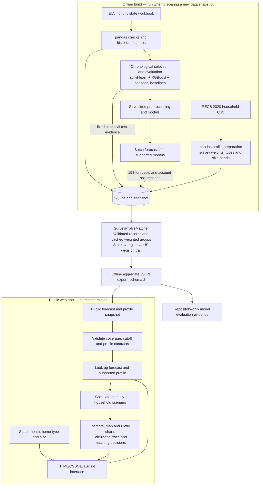

# HomePulse architecture — public web app and offline model

Updated November 18, 2026. The public app is `web-app-20261116/dist/`.
`app.py` → `homepulse.monthly_ui` remains the local Streamlit development prototype.
The original annual workspace remains separate.

## Household purpose and two data sources

HomePulse supports household electricity planning. EIA monthly state sales are used
to train the forecast; RECS (Residential Energy Consumption Survey) 2020 records are
used for survey-weighted home-type and size comparisons. The household calculation
combines those stages. RECS household characteristics are not state-model training
inputs, and state-level evaluation does not validate the household adjustment.

## Two execution paths

The SQLite snapshot is built **after** training and batch prediction, with observations
and evaluation evidence also copied into it. Model development reads prepared pandas
frames from the workbook; it does not require querying SQLite to fit XGBoost.

## Offline build

1. `scripts/download_monthly_sources.py` installs the included EIA state workbook
   and obtains the RECS CSV, verifying fixed SHA-256 checksums. Raw files are preserved.
2. `experiments/state-forecast-20261113/run_experiment.py` uses pandas to validate the
   state series, records a cleaning audit and writes a separate experiment database.
   It creates historical features using observations at least three months old.
3. The experiment fits preprocessing plus XGBoost, selects settings on validation,
   evaluates later test months and saves the complete pipeline and evidence.
4. `verify_and_report.py --checks-only` independently reproduces predictions and
   metrics, traces targets to the source and checks future-data leakage.
5. `scripts/build_monthly.py` verifies feature consistency with the experiment. It
   refits the chosen configuration at each supported production month's allowed
   cutoff, saves each pipeline, and calculates all 51 geographic forecasts in batch.
6. The same builder reads RECS, excludes identified solar homes from the profile
   extension, keeps survey weights and assigns size bands. It writes the final app
   database, source hashes, forecast CSV and build manifest.

The monthly database contains:

| Table | Contents | Row count |
|---|---|---:|
| `monthly_observations` | State, month, residential sales MWh, accounts, source status | 10,200 |
| `forecasts` | Three supported months × 50 states + D.C.; XGBoost and seasonal estimates | 153 |
| `profiles` | RECS household records for survey-based profile comparisons | 17,851 |
| `test_predictions` | Actuals and all model predictions for the fixed historical test | 1,632 |
| `test_state_metrics` | Every location and tested method's evaluation | 204 |
| `metadata` | JSON build manifest, source hashes, rules and limitations | 1 |

## Interactive runtime

The public app loads `web-app-20261116/dist/assets/homepulse-data.json`.
`dist/app.js` handles the map and form; `dist/model.js` calculates the estimate.
`dist/evidence-view.js` renders the calculation and geography decision trail.
`src/homepulse/peer_matching.py` validates and summarizes the survey profiles offline.
The exporter aggregates RECS profiles; it does not publish individual survey records.
The browser needs neither SQLite access nor a model file. Model names, test scores
and evaluation charts are absent from the public interface. Those remain in
`reports/monthly/` and `web-app-20261116/evidence/model-results.json` for review.

The local development prototype remains `app.py` → `src/homepulse/monthly_ui.py`.
`src/homepulse/monthly.py` opens SQLite read-only, and Streamlit caches it.

The four form inputs have different roles:

| Input | What it changes |
|---|---|
| State | Selects a stored state forecast and survey comparison geography |
| Month | Selects one of the supported forecast months, Sep–Nov 2026 |
| House type | Selects the survey profile group; does not retrain XGBoost |
| Floor area | Selects a defined survey size band; does not retrain XGBoost |

The app looks up stored forecast MWh and the held customer count. It calculates a
survey-weighted profile ratio using state, region or national data with minimum sample
support, then converts the state average to an experimental monthly household scenario.
It returns a clear failure when no suitable comparison exists. The code does **not**
load a joblib file or make a new XGBoost prediction on each form change.

In the public app, Plotly displays the selectable U.S. map, monthly outlook and
profile comparison. The XGBoost test scatter and baseline comparisons belong to
the repository and presentation. The public app can download the selected estimate.
The JavaScript calculation passed 3,366 comparisons with Python, including all
supported state/month/profile combinations; this verifies implementation parity,
not household predictive accuracy.

## Model artifacts and units

- Historical pipeline: `experiments/state-forecast-20261113/results/selected-backtest-model.joblib`.
- Production pipelines: `models/monthly/state-2026-09.joblib` through `state-2026-11.joblib`.
- Runtime database: `data/homepulse_monthly.sqlite`.
- Original annual model: `models/home-profile12.joblib`, used only by the annual workspace.

A bundle preserves fitted preprocessing, model, feature names, normalization mode and
cutoff metadata. Only locally generated, trusted model files should be loaded.

State outputs are MWh per month. The calculator multiplies by 1,000, divides by assumed
residential accounts and multiplies by the RECS profile factor to report kWh/month.
State evaluation does not validate that final household calculation. RECS annual
patterns are assumed to transfer across months and years; accounts are not identical
to occupied homes. These assumptions are surfaced in the app.

## Updating later

The current release is a fixed snapshot, not a live EIA feed. New data must pass the
same source/schema checks in a separately versioned build. Keep the inspected test
results and earlier snapshot, evaluate a new period for future changes, and promote
new artifacts only after checks pass. Re-export and publish the public snapshot after verification. Restart the local
Streamlit prototype when replacing its database so cached data is refreshed. No automatic scheduled retraining is implemented.

## Evidence and failure boundaries

The matching engine distinguishes insufficient sample support from malformed source
data. Only the former creates an unavailable profile in the snapshot; the latter
stops export. Each profile contains a decision trail and the two weighted means that
produce its factor. The browser checks these contracts before enabling the app.
It checks the selected forecast again, rejecting duplicate rows or invalid numbers.

The public calculation and the downloaded report carry the same evidence. Invalid
inputs remove the previous estimate and evidence together to avoid a stale result.
The [code walkthrough](code-walkthrough.md) documents the functions and failure tests.
No model is retrained by this change; the monthly household result remains a planning
scenario with separate validation work outstanding.
