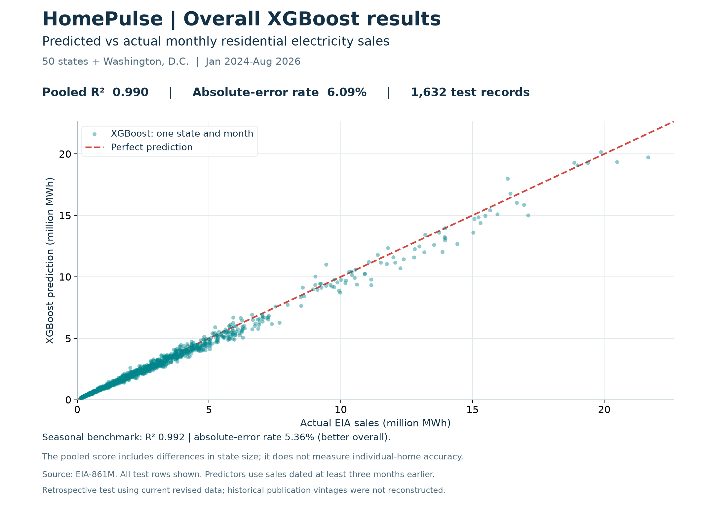

# HomePulse — model evaluation and XGBoost graph

## State forecast: predictions versus actual recorded sales

The state model is evaluated on 1,632 later state-month records, January 2024 to
August 2026. The actual target month's sales are kept out of prediction inputs.
Inputs use state/calendar fields and sales observations at least three months old.
The saved [hidden-answer audit](target-input-audit-20261114/result.json) reproduces
the historical predictions with target and after-cutoff sales hidden.
Six XGBoost candidates are compared on the earlier validation period before the
selected configuration is scored on the test period.

Each point is one state in one month. The horizontal axis is actual sales; the vertical
axis is predicted sales, both in million MWh. Points near the dashed diagonal are
close predictions. The pooled R² includes differences in state size.

| Test measure | XGBoost | Prior three-year same-month mean |
|---|---:|---:|
| Pooled R² | 0.9902 | 0.9924 |
| MAE (MWh per state-month) | 151,477 | 133,306 |
| WAPE | 6.09% | 5.36% |

The simple seasonal benchmark is stronger overall. Median within-state XGBoost R²
is 0.852, so the pooled result does not describe every state's performance. Keep the
[full per-state results](../reports/monthly/test-state-metrics.csv) alongside the
[overall results](../reports/monthly/test-comparison.csv).

`R² = 1 − sum((actual − predicted)²) / sum((actual − mean(actual))²)`.
MAE is mean absolute error. WAPE divides total absolute error by total actual sales.
These compare predicted and recorded **state residential electricity sales**;
they are not percentages of accurate household predictions.

The test uses revised historical data and refreshed lag histories. It is a series
of three-month-lead predictions with fixed test-model coefficients. Re-running it
checks reproducibility; it does not create a fresh independent evaluation.

## Household diagnostic

A separate historical annual calculation predicts RECS 2020 household KWH using
pre-2020 state-model fitting and development-only household profiles. Development,
calibration and evaluation households have disjoint IDs. The answer is revealed
for scoring after the prediction is created.

| Measure | Historical annual result |
|---|---:|
| Supported evaluation households | 3,515 |
| Unsupported evaluation households | 56 |
| Household R² | 0.279 |
| MAE | 4,259 kWh/year |
| MAE improvement versus regional median | 10.7% |
| Provisional improvement target | 15%, not met |
| Nominal interval / observed coverage | 80% / 80.2% |

The annual interval is broad (about ±6,455 kWh/year) and is not used for the public
monthly output. Region/home-type errors and weighted sensitivity checks are in the
[full household report](../reports/household-validation-20261115/household-validation-report.md).
The data were explored previously, so this is a historical diagnostic rather than
fresh independent external validation.

## Extra apartment inputs

Adding bedrooms, building age and heating fuel increased paired annual R² from
0.210 to 0.325 and reduced MAE from 2,640 to 2,377 kWh on the same 659 supported
apartments. The exact improvement was 9.9721%, narrowly below the experiment's 10%
rule. Heating fuel helped most. Full-cohort and subgroup scores are retained in the
[apartment report](../reports/apartment-inputs-20261116/apartment-input-report.md).
These fields remain an offline experiment; the public app still has four inputs.

## Software checks and their purpose

The Python monthly/map tests and 3,366 web/Python comparison cases verify code,
input handling, units, support rules and consistent outputs. The independent state
checks also reproduce saved predictions and scores. These are important engineering
checks, but they do not establish the reliability of monthly household estimates.
That remains a separate validation task.
