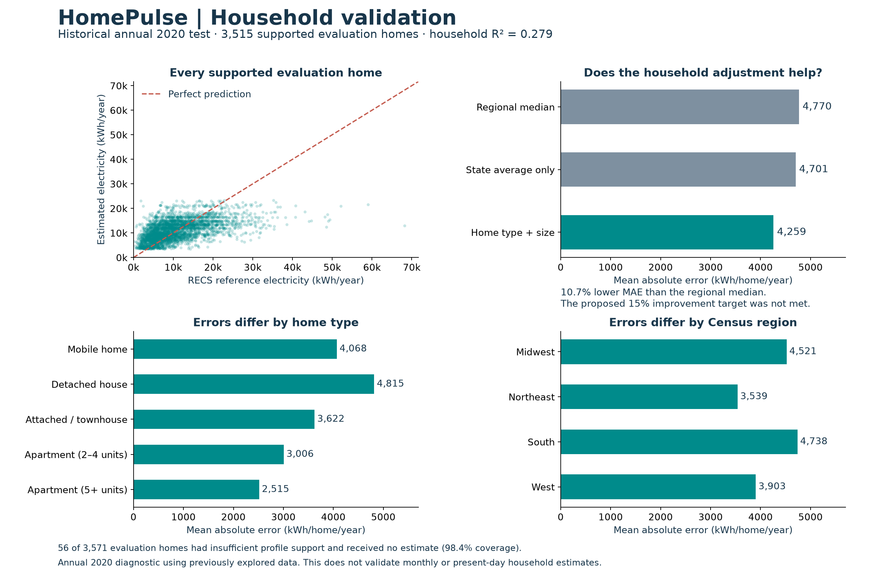

# HomePulse household validation — November 15, 2026

The current household adjustment improves on two simple baselines, but its individual-home errors remain substantial. The prespecified first-run benchmark was **not met**. This result does not support calling the current household output a precise electricity prediction.

## Main findings

- Evaluated annual estimates against the **same-year RECS 2020 annual KWH** reference.
- Predicted **3,515 of 3,571 evaluation homes** (98.4%); 56 had insufficient comparable-home support. No homes were removed for large errors or extreme electricity consumption.
- Mean absolute error: **4,259 kWh/home/year**. Household R²: **0.279**.
- **30.1%** of supported homes were within ±20% of their reference annual consumption; median absolute percentage error was **34.8%**.
- MAE improved **10.7%** over the regional-median baseline and **9.4%** over the unadjusted state/account estimate. The protocol required at least 15% improvement over the regional median and no worse error than the unadjusted state estimate; the first condition failed.
- Supplying observed state averages instead of forecasts left household error almost unchanged. This is evidence that the home-profile method itself needs attention, beyond improving state forecasts.

## Fixed method and leakage controls

The November 14 protocol was saved before this run. Of 18,496 source households, the app's existing exclusion of 645 identified-solar homes leaves 17,851 eligible records. Apartment solar status is not measured. No new outlier filtering was used.

With seed 20261114, stratified by home type and Census region, 10,710 homes formed development profiles, 3,570 formed the uncertainty-calibration group and 3,571 formed the evaluation group. IDs are persisted and disjoint. Both the profile numerator and its geographic reference denominator use development homes only. State → region → national fallback and the app's fixed size bands, minimum 50 records and effective sample 30 were retained.

The state model was recreated for historical 2020. Six configurations were compared using only pre-2020 validation; the winner was refitted through September 2019. Its coefficients remain fixed through 2020. Every target month's sales inputs and held account count are dated at least three months earlier. Earlier 2020 state observations may therefore enter later months' inputs, without refitting the model. These are rolling historical predictions, not twelve forecasts all issued in 2019.

For each evaluation home, the method sums twelve 2020 monthly state forecasts, divided by the permitted customer counts and multiplied by a development-only home-type/size factor. The input function receives only survey ID, state, region, home type and area; it never receives that home's KWH. Predictions are saved before joining household outcomes for scoring. IDs and region are lookup metadata; users continue to have the same four app inputs.

Because development profiles use other **2020** homes, this is a retrospective household generalization check, not an as-issued forecast of 2020 using only 2019 information.

## Baselines and error measures

The primary baseline is the unweighted median annual KWH of development homes in the same Census region. The second baseline is the same annual state/account forecast without the household factor. All methods below are scored on the identical 3,515 supported homes. MAE is the primary measure; RMSE, R², bias and percentage-error measures are supporting evidence.

| Method | MAE, kWh/year | RMSE, kWh/year | R² | Within ±20% |
|---|---:|---:|---:|---:|
| Historical household method | 4,259 | 5,849 | 0.279 | 30.1% |
| Regional median baseline | 4,770 | 6,719 | 0.049 | 26.4% |
| Unadjusted state/account baseline | 4,701 | 6,434 | 0.128 | 27.1% |
| Component diagnostic: observed state values | 4,299 | 5,849 | 0.280 | 30.0% |

The observed-state component diagnostic supplies actual state values. It is not a forecast score and must not be presented as an operational model result. It isolates the remaining household estimation error.

The household R² here is distinct from the existing 0.990 state-month R². The recreated 2020 state stage had pooled R² 0.985; neither state score measures household accuracy.

## Errors by home type and region

Coverage denominators include unsupported profiles. Report all groups; do not select only favorable ones. Full state results are in the subgroup CSV, with fewer-than-50 supported records flagged as low support.

| Group | Predicted / evaluation homes | MAE, kWh/year | R² | Coverage of nominal 80% interval |
|---|---:|---:|---:|---:|
| Mobile home | 178 / 191 | 4,068 | 0.183 | 79.2% |
| Detached house | 2,347 / 2,347 | 4,815 | 0.191 | 75.2% |
| Attached house / townhouse | 331 / 343 | 3,622 | 0.070 | 86.7% |
| Apartment (2-4 units) | 179 / 201 | 3,006 | 0.180 | 91.6% |
| Apartment (5+ units) | 480 / 489 | 2,515 | 0.150 | 96.2% |
| Midwest | 745 / 757 | 4,521 | 0.226 | 78.3% |
| Northeast | 684 / 699 | 3,539 | 0.242 | 89.2% |
| South | 1,245 / 1,266 | 4,738 | 0.199 | 75.4% |
| West | 841 / 849 | 3,903 | 0.215 | 81.6% |

## Survey weights and comparison limits

`NWEIGHT` is used for development profile means. Primary errors treat each evaluation home equally. NWEIGHT-weighted sensitivity results are MAE **4,083 kWh/year** and R² **0.322**. These are separate from the primary results, not a replacement selected because the score is higher.

The full weighted and unweighted error tables are saved. This run does **not** compute survey-design confidence intervals for population comparisons. EIA's replicate-weight method remains appropriate for that separate task; split-sample adjustments would need consideration. Survey-weight uncertainty for a group average is different from the predictive uncertainty for one home.

RECS primary residences and utility residential accounts are different populations. RECS KWH contains total electricity including self-generated solar, while state sales represent supplied electricity. Excluding known solar homes reduces but does not eliminate that mismatch. RECS consumption values include EIA annualization/imputation; they are reference estimates, not error-free meter measurements for every home.

## Uncertainty for one annual estimate

Using only supported calibration homes, the 80% nominal absolute-residual interval has half-width **6,455 kWh/year**, with the lower endpoint clipped at zero. Evaluation coverage was **80.2%**, with mean total width **12,675 kWh/year**.

That broad interval is informative about the limitations: reaching approximately 80% average coverage does not make the point estimate precise. Coverage varies by subgroup, and there is no guarantee for a particular home, a future year or the U.S. population. This annual interval is **not** installed in the monthly app.

## What this means for Deliverable 2

Suggested wording:

> I tested the household calculation against withheld 2020 household outcomes, using separate development, calibration and evaluation homes. The household adjustment lowered average error by 10.7% compared with a regional median, but individual errors remain large and our 15% improvement benchmark was not met. State-level accuracy does not establish home-level accuracy. The next task is improving or limiting the household estimate and validating monthly outputs with compatible household outcomes.

This directly addresses Abel's requests for a named baseline, error measure, improvement criterion, subgroup results, weight handling and uncertainty. Replicate-weight population confidence intervals and present-day/monthly external validation remain unfinished. John’s request is addressed by the bounded six-candidate state selection and explicit leakage checks, without further tuning against evaluation outcomes.

## Recommended next decision

Keep the current household output labeled as an exploratory scenario. A four-input state/month/type/size adjustment does not currently support a precise individual-home claim. The strongest immediate next step is to compare this result with the already documented richer household-characteristics models, using an appropriate common evaluation protocol before choosing a direction. Any new experiment should be specified before it runs; this evaluation has now been inspected.

A monthly or current-year household accuracy claim needs matching household outcomes. Bills or meter readings can be hidden evaluation labels without becoming an additional input users must provide to make a prediction.

## Reproducibility and integrity

- Source CSV, database, code, protocol and package versions are hashed/recorded in the run manifest.
- `integrity-checks.json` records hidden-target checks for all 612 historical state-month predictions and household split isolation.
- `independent-verification.json` separately reconstructs all 3,515 supported household predictions from development profiles, checks all 612 account counts, recomputes baselines, weighted/unweighted metrics and interval coverage.
- The app, monthly source files and production database hashes are unchanged.
- The 2020 records and model family have already been examined during prior development. This is a transparent historical diagnostic, **not a fresh independent external test**. Revised state data were used rather than historical publication vintages.

Source documentation: [EIA RECS 2020](https://www.eia.gov/consumption/residential/data/2020/index.php?view=microdata), [EIA weighting guide](https://www.eia.gov/consumption/residential/data/2020/pdf/microdata-guide.pdf), [EIA state electricity data](https://www.eia.gov/electricity/data/state/).
